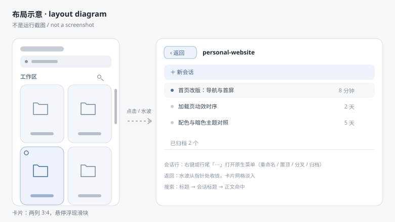

# dsh-folder-cards

Turn the **DeepSeek Harness (DSH)** sidebar's workspace region into **portrait folder cards**: one card per folder, and a droplet transition into that folder's conversations — with a reverse ripple when you go back.



> The image above is a layout diagram. Real screenshots are welcome in `docs/screenshots/` — PRs accepted.

## What it does

DSH lists workspaces as rows of text. With many projects the list gets long, and it is hard to tell which folder changed recently. This plugin renders each workspace as a 3:4 card (folder glyph + name), opens its sessions on click, and keeps search, context menus and archiving in place.

## Features

- **Cards**: two per row, 3:4 portrait, sized so two cards plus the gap fill the sidebar; they scale down with it.
- **Artwork**: folder glyph + folder name by default; hover a card to insert an image (downscaled to 320px, stored in `localStorage`) or reset to default. All colors use `--dsw-alias-*` theme tokens, light/dark included.
- **Browse**: click a card for a droplet ripple, then the folder's sessions surface; the back button collapses the ripple into the pointer. Rows show title, relative time and a running dot; "＋ New session" sits on top of the list.
- **Fixed sidebar**: the "Workspaces" header row and everything above it stay put — only the card area scrolls, with a hover-revealed slim scrollbar you can drag, page-jump or drive from the keyboard.
- **Search**: the magnifier swaps the title for an input; 250ms debounce, folders first, then conversation titles, then Host content hits (`ctx.sessions.search`).
- **Actions**: right-click a row (or the hover "⋯") for the native session menu — rename, pin, fork, copy id, archive/unarchive, with items following permissions. Right-click a card for the native workspace menu. Archived sessions stay reachable through an expandable trailer.
- **View options**: sort by folder order or recent activity; remembers the last opened folder.
- **Fallback menu**: if the shell ever stops providing the native session menu, the plugin shows its own (inline rename, fork, copy id, archive) instead of dead buttons.

## Install

Requires DSH `0.2.2-rc.x` (see `engines.dsh`) and a Web profile.

```sh
# from GitHub
dsh plugin --profile desktop add github:<your-user>/dsh-folder-cards

# from npm (once published)
dsh plugin --profile desktop add dsh-folder-cards
```

Then hard-refresh the page (`Ctrl+F5`).

## Compatibility

`engines.dsh: ">=0.2.2-rc.1 <0.3.0"`, developed against `0.2.2-rc.3`. It claims the `sidebar.workspaces` seat with priority `-1` over the shipped `0` registration; nothing official is written, so disabling the plugin restores the native list.

## Known limitations

- Taking over the whole region drops the native **group/sort view menu** and any `sidebar.session.row.*` decorations from other plugins.
- The region height is tuned by measuring the shell's overflow at runtime; that is the first suspect when a DSH update changes the sidebar layout.
- UI text is zh/en only; no automated tests yet; 3:4 cards trade density for looks.

## Development

`src/` holds the sections; `build.mjs` concatenates them into the single `client.js` the module loader requires (`factory(require)` only resolves package names, so no relative modules).

```sh
npm run build
```

## Contributing

Issues and PRs are very welcome: real screenshots, layout-adaptation hardening, drag-to-reorder, the missing view options, hit highlighting in search, more locales, and a smoke-test suite. Please include your DSH version, OS and any `[folder-cards]` console errors.

## License

[MIT](LICENSE)
