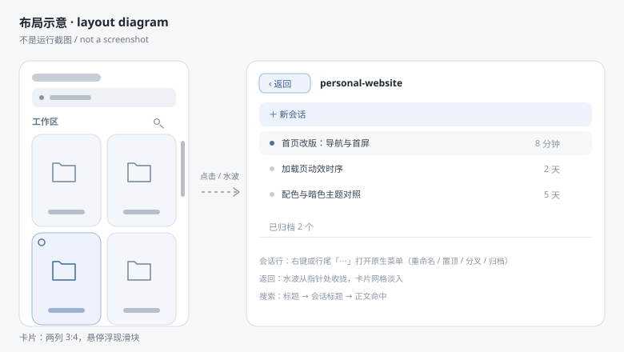

# dsh-folder-cards

把 **DeepSeek Harness（DSH）** 左侧的「工作区」区换成**竖版文件夹卡片**：一个文件夹一张卡，点开就以水波过渡进入这个文件夹里的会话列表，返回时水波收回。



> 上面是布局示意图，不是运行截图。真实截图欢迎使用后补到 `docs/screenshots/`，提 PR 我会合并。

## 为什么做这个

DSH 默认侧栏把所有工作区摊成一列文字。项目一多，滚动条长、扫视慢，也很难一眼看出「哪个文件夹最近动过」。

这个插件把工作区变成一排 3:4 的小卡片：文件夹图标 + 名称，点进去才是这个文件夹的会话；搜索、右键菜单、归档这些日常操作都在原地保留。

## 功能

**外观**

- 两列网格，每行两张卡片，卡片宽高比 **3:4**（竖边略长）；两张卡 + 间隙正好铺满侧栏宽度，窗口变窄时等比缩小。
- 默认外观是文件夹图标 + 文件夹名（标题为空时退回路径最后一段，再用「未命名工作区」兜底），名字过长单行省略。
- 悬停卡片右上角可**插入图片**替换外观、或一键恢复默认；图片自动缩到最长边 320px，存在浏览器本地，刷新/重启不丢。
- 全部配色走 DSH 主题令牌（`--dsw-alias-*`），明暗主题自动跟随；动效尊重系统的「减少动态效果」。

**浏览**

- 点卡片：从指针位置荡开水波，约 150ms 后浮现该文件夹的会话列表；点返回，水波反向收拢、卡片网格淡入回来。
- 会话行显示标题 + 相对时间，运行中的会话有常亮圆点；列表最上方是「＋ 新会话」和「返回」。
- 侧栏折叠成窄栏时，卡片退化为单列图标按钮，点一下先展开侧栏再进入。
- 不属于任何工作区的会话单独成一张「未分组」卡，不会凭空消失。
- 「工作区」标题行与侧栏上方（品牌行、新会话按钮）**固定不动**，只有标题行下面的卡片区滚动；右侧有一条悬停才浮现的细滑块，可拖动、点轨道跳转、键盘操作。

**检索**

- 标题行放大镜切成输入框，输入即搜（250ms 防抖）：文件夹标题/路径 → 会话标题 → Host 内容索引（`ctx.sessions.search`）的正文命中，结果一行一条，点击直达。
- 搜不到、搜索中、加载中都有明确状态，不会把「加载失败」显示成「还没有工作区」。

**操作**

- 会话行右键或行尾「⋯」：原生会话菜单——重命名、置顶/取消置顶、分叉、复制会话 ID、归档/取消归档，菜单项随权限与状态自动增减。
- 文件夹卡片右键：原生工作区菜单（重命名 / 删除）。
- 已归档会话不隐藏，列表底部有「已归档 N 个」展开区，点一条即恢复。
- 视图选项（标题行滑杆）：排序可在「默认顺序 / 最近活跃」间切换，并记住上次打开的文件夹。
- **降级菜单**：如果外壳不再提供原生会话菜单，行尾「⋯」会改用插件自带菜单（行内重命名、分叉、复制 ID、归档/取消归档），不会变成死按钮。

## 安装

需要 DSH `0.2.2-rc.x`（见 `package.json` 的 `engines.dsh`），并在 Web profile 中启用。

**从 GitHub（推荐，尚未发布 npm 时）**

```sh
dsh plugin --profile desktop add github:changhao213141/dsh-folder-cards
```

**从 npm（发布之后）**

```sh
dsh plugin --profile desktop add dsh-folder-cards
```

**本地目录（开发用）**

把本目录作为插件安装（插件管理器支持本地目录），或在「设置 → 插件」里添加该绝对路径。

安装后刷新页面（`Ctrl+F5`）即可看到；客户端插件代码改动需要整页重载才生效。

## 兼容性

- 声明 `engines.dsh: ">=0.2.2-rc.1 <0.3.0"`；开发与实测版本为 **0.2.2-rc.3**。
- 接管的是通道 `sidebar.workspaces` 的座位（priority `-1`，官方注册为 `0`），未注册的座位声明、原生浮层、右键菜单和会话操作都继续工作。
- 卸载/禁用后官方工作区列表原样回来：本插件不写任何官方状态，卡片图片和视图偏好只存在浏览器 `localStorage`。

## 已知限制

- 接管整块区域后，原生区头的**分组/排序视图弹层**不再出现；别的插件挂在 `sidebar.session.row.*` 上的行内装饰也不会渲染。
- 区域高度是**运行时测量外壳几何**闭环校正的（外层视口溢出多少就削多少），DSH 大改侧栏布局时这里最值得怀疑；报错或行为异常请附版本号。
- 只提供中文/英文界面文案，其它语言回退英文。
- 目前**没有自动化测试**，验证主要靠手动回归。
- 3:4 卡片比列表占纵向空间，工作区很多时更依赖搜索。

## 开发

```
src/00-config.js        常量（locale 命名空间、存储键、图片上限、空快照）
src/10-locales.js       zh/en 词典
src/20-styles.js        组件内样式（只用主题令牌）
src/30-storage.js       localStorage：卡片图片 + 视图偏好
src/40-helpers.js       纯函数：标题、相对时间、运行态、图片缩放
src/45-icons.js         内联 SVG 图标
src/50-scroll-region.js 滚动区（外壳滚轮交接 + 悬停滑块）
src/60-component.js     侧栏区域：卡片、会话面板、搜索、归档、视图选项
src/90-entry.js         客户端入口：词典注册、api、slot 注册
build.mjs               把 src 按文件名顺序拼成 client.js
```

为什么是单文件产物：DSH 的客户端插件由 `window.__ModuleLoader__.load({ id, factory })` 加载，`factory(require)` 里的 `require` 只解析模块表里的**包名**、不支持相对路径，所以浏览器半必须是一个脚本。这里用一个零依赖的拼接构建脚本，改完源码执行：

```sh
npm run build   # 或 node build.mjs
```

`client.js` 是构建产物，`src/` 是唯一手改的地方。

## 参与贡献

非常欢迎 PR / Issue / 设计建议。这个插件还处在「能日常用，但离产品还有距离」的阶段，尤其需要：

- **真实截图与体验反馈**：截图、录屏、在哪些 DSH 版本上出问题。
- **外壳适配**：把「区域高度闭环测量」替换成更稳的方案（如果官方暴露了排版变量就更好），以及新版本 DSH 上的回归。
- **功能**：拖拽排序、视图选项补全（分组/排序弹层）、搜索命中高亮、跨平台快捷键核对。
- **国际化**：补其它语言文案（目前 zh / en）。
- **测试**：至少一套冒烟脚本（构建产物语法、manifest、slot 注册）。

提 issue 时请带上：DSH 版本、操作系统、复现步骤、控制台报错（`[folder-cards]` 开头）。

## 许可

[MIT](LICENSE)
